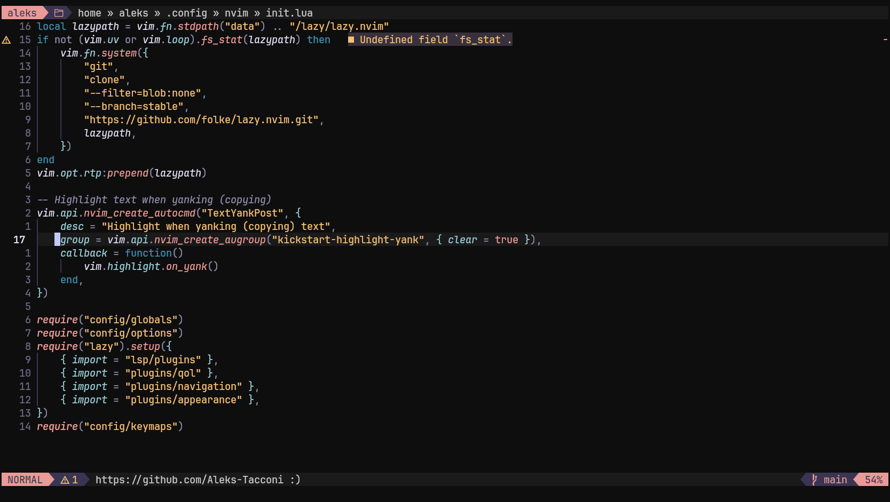

# Neovim Configuration

A personal and opinionated Neovim config. Features include:

- LSP, diagnostics, completion, and native snippets
- File, buffer, and project navigation
- Git tools
- Markdown and MDX support with general editing quality-of-life

## Screenshot



## Prerequisites

Core tooling:

- Neovim `0.12+`
- `git`
- `ripgrep`
- `fd`
- `tree-sitter` CLI `0.26.1+`, a C compiler, `curl`, and `tar` for Treesitter parsers

Optional but useful:

- `lazygit`
- language-specific LSPs and formatters (See my [NixOS config](https://github.com/Aleks-Tacconi/NixOSConfig) for more details)
- Jupytext, Jupyter, a Python provider, and ImageMagick on PATH for notebooks and images
- for QML projects, expose your Qt/QML modules through `QML_IMPORT_PATH` or `QML2_IMPORT_PATH` so `qmlls` can resolve imports

## Setup

1. Backup your current config if you want to keep it:

    ```sh
    mv ~/.config/nvim ~/.config/nvim-backup/
    ```

2. Clone this repository into `~/.config/nvim`:

    ```sh
    git clone https://github.com/Aleks-Tacconi/nvim-config.git ~/.config/nvim
    ```

3. Sync plugins and Treesitter parsers:

    ```sh
    nvim --headless "+Lazy! sync" "+lua require('nvim-treesitter').install(require('config.treesitter').parsers):wait(300000)" "+qa"
    ```

4. Open Neovim and let Lazy finish any first-run setup.

## Structure

- `lua/config/` for globals, options, keymaps, filetypes, and autocmds
- `lua/config/treesitter.lua` for parser installation and native highlighting
- `lua/plugins/qol/snacks.lua` for search pickers and input/select dialogs
- `lua/plugins/navigation/` for search and movement plugins
- `lua/plugins/qol/` for editing, git, and markdown
- `lua/plugins/appearance/` for UI and theme-related plugins
- `lua/lsp/plugins/` for language tooling

## Useful Files

- General keymaps: `lua/config/keymaps.lua`
- Core autocmds: `lua/config/autocmds.lua`
- Rose Pine theme setup: `lua/plugins/appearance/colorscheme.lua`
- Search pickers: `lua/plugins/qol/snacks.lua`
- LSP keymaps: `lua/lsp/config/keymaps.lua`
- Main plugin loading: `init.lua`

## Editing defaults

- `Ctrl-H` and `Ctrl-L` select the previous and next quickfix entries.
- `Ctrl-Backspace` deletes the previous word in Insert and Command-line modes.
- Completion uses `Ctrl-J`/`Ctrl-K` to select, `Ctrl-Y` to accept, and `Ctrl-E` to cancel.
- `Tab`/`Shift-Tab` move between snippet placeholders.
- Search uses Snacks Picker: `<leader>sf` for files, `<leader>sg` for grep, and `<leader>sd` for diagnostics.
- `gr` finds LSP references, `gi` finds implementations, and `z=` opens spelling suggestions.
- Use native `Ctrl-W` commands to move between windows.
- Swap files and write backups are disabled; persistent undo is enabled.
- Plugins are managed with lazy.nvim; Treesitter uses its current `main` API.

## Git review

- `:DeltaView` or `<leader>v` opens a unified diff of the current file against HEAD (or the last selected ref).
- `:DeltaMenu` or `<leader>dm` selects a changed file through Snacks; `:DeltaMenu!` opens the quickfix review workflow.
- `:Delta .` reviews changes across the current directory; `<leader>da` opens the current path's diff.
- In a diff, `Tab`/`Shift-Tab` move between hunks and `q`/`Esc` return to the source file.
- Oil shows `+N -N` for tracked changes, `??` for untracked files, and `~` for changes without line counts.
